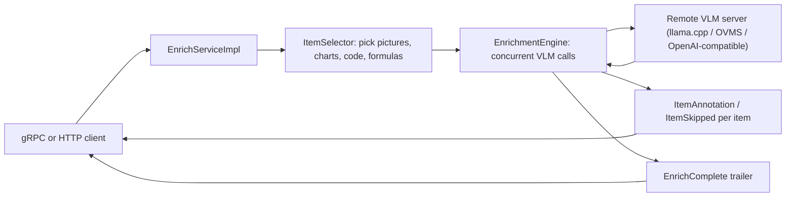

# grpc-enrich

gRPC enrichment service: VLM picture-describe, chart extract, and formula/code
annotations on a gRParse Document.

Java gRPC server. A `Document` in, a live stream of typed `ItemAnnotation` /
`ItemSkipped` events out, keyed by `self_ref`. The VLM is a remote server
(llama.cpp, OVMS, or any OpenAI-compatible HTTP endpoint) that this process
calls; no model weights, no torch, no transformers in this binary. Diskless:
documents live only in memory for the duration of the RPC.



## Build and test

Requires JDK 25 and (for proto lint) buf.

```sh
./gradlew build        # compiles, generates stubs from proto/, runs tests
buf lint               # STANDARD + COMMENTS, vendored document.proto exempt from COMMENTS
./gradlew :enrich-service:installDist
```

Tests run against an in-process fake VLM HTTP endpoint (no network, no
weights), including proof that events stream before the client half-closes
and that per-item events are never held back into a batch.

## Run

```sh
ENRICH_VLM_URL=http://localhost:8080 \
  enrich-service/build/install/enrich-service/bin/enrich-service
```

| Env | Default | Meaning |
|---|---|---|
| `ENRICH_PORT` | `50056` | gRPC listen port |
| `ENRICH_HTTP_PORT` | unset (off) | HTTP front-end listen port. Off unless set: gRPC is the API, and the JSON shim opens only when an operator asks for it (`50068` is the port reserved for it). `0` or empty also leaves it off |
| `ENRICH_VLM_URL` | unset | Default VLM endpoint: a base URL (`http://vlm:8080`; the client posts to `<url>/v1/chat/completions`) or a full endpoint URL (see [VLM endpoint URLs](#vlm-endpoint-urls)). Logs and `GetServiceInfo` show only its origin |
| `ENRICH_VLM_API_KEY` | unset | Bearer token sent as `Authorization` to `ENRICH_VLM_URL` only, never to a per-request endpoint. Use it instead of a credential in the URL |
| `ENRICH_VLM_MODEL` | unset | The model `ENRICH_VLM_URL` serves, for example `Qwen2.5-VL-7B-Instruct`. A general VLM (anything not a CodeFormula, granite-docling or SmolDocling model) gets formula images with a LaTeX prompt and the item's text layer as a hint, instead of the bare `<formula>` token it does not know. `EnrichOptions.formula_prompt` overrides per request. Unset keeps the token prompt |
| `ENRICH_VLM_PROBE_INTERVAL_SECONDS` | `15` | Seconds between health probes of `ENRICH_VLM_URL` and each `ENRICH_VLM_ENDPOINT_ALLOWLIST` origin (1 to 3600). See [Health](#health) |
| `ENRICH_ALLOW_REQUEST_ENDPOINT` | `false` | `true` lets a request name any http(s) VLM endpoint on a public address (`EnrichOptions.vlm_endpoint`, `chart_extraction.vlm_endpoint`); otherwise such a request is `PERMISSION_DENIED`. See [Security](#security) |
| `ENRICH_VLM_ENDPOINT_ALLOWLIST` | unset | Comma-separated origins (`https://vlm.internal:8443`) a request may name even when `ENRICH_ALLOW_REQUEST_ENDPOINT` is off. The origin of `ENRICH_VLM_URL` is always allowed and need not be listed |
| `ENRICH_MAX_DOCUMENT_MIB` | `70` | Byte cap on a document (inline or chunked) plus its `ItemImage` crops (`RESOURCE_EXHAUSTED` above); also sizes the HTTP body limit |
| `ENRICH_MAX_CONCURRENT_VLM` | cores (min 2) | Process-wide cap on concurrent VLM calls, shared by every request; also bounds `EnrichOptions.concurrency` |
| `ENRICH_VLM_TIMEOUT_SECONDS` | `300` | Per-VLM-call timeout (the reply body included), and the ceiling on `EnrichOptions.timeout_seconds` |
| `ENRICH_METRICS_INTERVAL_SECONDS` | `60` | Metrics line interval; 0 disables. The line counts documents started and completed, items annotated and failed, and skips by reason (`docs{started=..,completed=..} items{annotated=..,failed=..} skipped{no_image=..,vlm_error=..,...} rpcs{rejected=..}`), so a VLM that is down reads as `annotated=0` with the items under `vlm_error`. Each distinct VLM failure message is also logged once at WARNING |

The server registers `grpc.health.v1.Health` and server reflection (v1 and
v1alpha).

### Health

Health follows the VLM, because a grpc-enrich with no VLM answers every RPC
OK and skips every item.

- **Startup.** With `ENRICH_VLM_URL` unset, no
  `ENRICH_VLM_ENDPOINT_ALLOWLIST` and `ENRICH_ALLOW_REQUEST_ENDPOINT` off,
  no request could ever reach a VLM and the server refuses to start.
- **Probe.** At startup and every `ENRICH_VLM_PROBE_INTERVAL_SECONDS` the
  server GETs the model list of `ENRICH_VLM_URL` (the sibling of its
  chat-completions URL, `/v1/models` for llama.cpp and OpenAI, `/v3/models`
  for OVMS) and of each allowlisted origin (`<origin>/v1/models`). The probe
  costs no generation and does not queue behind running completions.
  `ENRICH_VLM_API_KEY` is sent to `ENRICH_VLM_URL` only. An endpoint is
  serving when it answers below 500 and does not refuse the credential
  (401/403); a connection failure, no answer within 5 s, or a 5xx (llama.cpp
  answers 503 while it loads a model) is not serving.
- **Rule.** With `ENRICH_VLM_URL` set, health is that endpoint's state. With
  only an allowlist, health is SERVING while at least one allowlisted origin
  answers. With only `ENRICH_ALLOW_REQUEST_ENDPOINT=true` there is nothing
  to probe and health is SERVING. Until the first probe finishes, health is
  NOT_SERVING.
- **Where it shows.** `grpc.health.v1.Health/Check` and `Watch` (for `""`
  and `ai.pipestream.enrich.v1.EnrichService`), `GET /healthz` on the HTTP
  front end when it is on, and `GetServiceInfoResponse.vlm_endpoints`: one typed
  `VlmEndpointStatus` per probed endpoint with its origin, state, the reason
  when it is not serving, and the model ids it lists.

A NOT_SERVING server still accepts RPCs: items come back as
`ItemSkipped{SKIP_REASON_VLM_ERROR}` with the reason, and a request that
names its own reachable endpoint still works.

## Wire API

`ai.pipestream.enrich.v1.EnrichService` (see
[`proto/ai/pipestream/enrich/v1/enrich_service.proto`](proto/ai/pipestream/enrich/v1/enrich_service.proto)):

- `EnrichDocument(stream EnrichDocumentRequest) returns (stream EnrichDocumentResponse)`:
  the first message carries `EnrichOptions` (one boolean per job:
  `do_picture_description`, `do_chart_extraction`, `do_code_enrichment`,
  `do_formula_enrichment`, enum presets with `*_raw` fallbacks, endpoint /
  concurrency / timeout overrides, and Docling's `picture_description_api`
  extras as typed fields: `picture_description_prompt`,
  `picture_description_params` (model, max_tokens, temperature, top_p, seed),
  and `vlm_headers` for a per-request endpoint) plus the document inline or as
  `DocumentChunk` slices; `ItemImage` messages carry stripped crops, sent
  before the chunk marked complete (at most 100000, inside the byte cap).
  Events: `EnrichStarted` (counts selected), one `ItemAnnotation` or
  `ItemSkipped` per item as that VLM call returns, `EnrichComplete` trailer.
  Chart extraction lands as typed `TableData` cells, never CSV-only. A failed
  VLM call is an `ItemSkipped` (`SKIP_REASON_VLM_ERROR`), never an RPC error.
  Every `ItemAnnotation` carries its `generation` (the model, the endpoint's
  `finish_reason` verbatim, and that reason classified as `stop_reason`).
  `model` (and `generation.model`) is the model the endpoint names in its
  reply, the one that answered; `requested_model` is the name this service
  sent (a preset's alias or the request's own). llama.cpp and OVMS serve what
  they have loaded whatever name they are asked for, so the two can differ.
  When the endpoint names no model, `model` stays empty: the requested name
  is never put in its place. A
  reply the model stopped at its token limit is never passed off as whole: a
  code or formula transcription, a chart table or chart code cut that way is
  an `ItemSkipped` (`SKIP_REASON_OUTPUT_TRUNCATED`) and replaces nothing; a
  picture description or chart summary is kept, with
  `generation.stop_reason = VLM_STOP_REASON_LENGTH`. With `return_document`,
  each patched item also gains that generation in its `source` list.
- `GetServiceInfo`: versions, the default endpoint's origin, byte cap,
  process-wide concurrency cap, and the `UiInfo` frontend advertisement (tab
  title/path/tooltip) shared with the other ai-pipestream services.

`ai/pipestream/document/v1/document.proto` is vendored verbatim from gRParse
(the canonical copy); do not edit it here.

## HTTP API

The same binary can also serve an HTTP front end, **off by default**: set
`ENRICH_HTTP_PORT` (the fleet reserves `50068` for it) to turn it on. gRPC is
the API; the shim takes the typed `Document` as JSON text and re-encodes it on
the way in, so it is a convenience for callers that cannot speak gRPC, not a
path fleet services use. It is a thin shim over the gRPC
`EnrichServiceImpl`: requests are driven through the same streaming code
path, so events, skip semantics, and the byte cap are identical. All bodies
are canonical proto3 JSON (protobuf `JsonFormat`): camelCase or snake_case
keys, enum names, base64 bytes. `GetServiceInfo` stays gRPC-only.

Request body for both enrich endpoints:

```json
{
  "options": {"doPictureDescription": true, "document": {"name": "doc", "...": "..."}},
  "item_images": [{"selfRef": "#/texts/0", "data": "...base64...", "mimetype": "image/png"}]
}
```

`options` is an `EnrichOptions` message (the document may ride inline in
`options.document`, as here) and `document` is an optional top-level
`Document` message (mutually exclusive with `options.document`; it goes the
chunked route, so `item_images` crops apply). The byte cap applies either
way. A body over 4/3 of the byte cap plus 1 MiB is answered 413 before it is
parsed (from `Content-Length` when present, without reading the body).

- `POST /v1/enrich`: collects the whole stream and returns it at once:
  `{"events": [<EnrichDocumentResponse as proto3 JSON>, ...]}` in stream
  order (started, per-item annotation/skipped, complete trailer).
  `200` on success, `400` on `INVALID_ARGUMENT` (malformed JSON, no
  document), `403` on `PERMISSION_DENIED` (a per-request endpoint the
  operator has not allowed), `413` on `RESOURCE_EXHAUSTED` (byte cap, body
  limit), `500` otherwise.
- `POST /v1/enrich/stream`: the same request, answered as chunked NDJSON
  (`application/x-ndjson`): each `EnrichDocumentResponse` is written as one
  flushed line the moment the stream produces it, so HTTP callers see the
  same live per-item events gRPC clients get. A mid-stream failure ends the
  response with a final `{"error": "...", "code": "<gRPC status code>"}` line
  (for example `UNAVAILABLE`); error bodies of both endpoints carry the same
  `code` whenever the failure came from the RPC. When the client hangs up,
  the next event write fails and the call is cancelled, so its VLM calls
  stop.
- `GET /healthz`: `200 ok` while a VLM the server depends on is answering,
  `503 not serving` while none is (see [Health](#health)).

```sh
# Sync: one JSON document with every event
curl -s localhost:50068/v1/enrich -d '{
  "options": {"doPictureDescription": true, "document": {"name": "doc", "pictures": ["..."]}}
}'

# Async: live per-item events as NDJSON
curl -sN localhost:50068/v1/enrich/stream -d '{
  "options": {"doPictureDescription": true, "document": {"name": "doc", "pictures": ["..."]}}
}'
# {"started":{"pictureDescriptions":2}}
# {"annotation":{"selfRef":"#/pictures/0","description":{"text":"a QR code"}, "...": "..."}}
# {"annotation":{"selfRef":"#/pictures/1","description":{"text":"..."}, "...": "..."}}
# {"complete":{"succeeded":2}}
```

## Enrichment semantics

Item selection. A picture is described when its area is at least
`picture_description_area_threshold` of its page's area; unset (0) or NaN
applies the default 0.05, and a negative value disables the threshold.
Pictures without provenance or a known page size are treated as full-page and
always pass. Chart extraction runs when the picture's top figure-class
prediction is one of the supported chart types (`bar_chart`, `pie_chart`,
`line_chart`) or the picture carries the label `DOC_ITEM_LABEL_CHART`. The
two jobs are independent, as in Docling: a chart picture with both
`do_picture_description` and `do_chart_extraction` set is described and
extracted, and each job answers with its own event. Code
and formula items are selected by their existing item labels; this service
does not re-run layout.

Prompts are fixed per job. Picture description: `Describe this image in a few
sentences.` (SmolVLM preset) or `What is shown in this image?` (Granite
Vision preset), unless `picture_description_prompt` replaces it (Docling
`picture_description_api.prompt`). Chart, without
`EnrichOptions.chart_extraction`: one call per chart, `Convert the
information in this chart into a data table in CSV format.` Code and
formula with an image crop: the bare `<code>` / `<formula>`.

Chart outputs (`EnrichOptions.chart_extraction`, the Docling chart stage).
Three independent outputs, each its own VLM call per chart and its own event:
`csv` (default on) becomes a `ChartTable`, `summary` a `ChartSummary`, `code`
a `ChartCode` (Python). The prompts are the Granite Vision special tokens
`<chart2csv>`, `<chart2summary>`, `<chart2code>`, or with
`natural_language_prompts` Docling's natural-language equivalents, verbatim.
Post-processing follows Docling: the CSV is the body of the first fenced
`csv` block when there is one (otherwise the reply with stray fences
stripped); the summary is the reply verbatim; the code is the body of the
first fenced `python` block. A reply that yields nothing usable (a blank
summary, no python fence, unparseable CSV) skips that output only, as an
`ItemSkipped` whose `chart_output` names it; the chart's other outputs still
land. `chart_extraction.model` and `chart_extraction.vlm_endpoint` route the
chart calls to their own model and endpoint without touching the other jobs.
All three outputs switched off is `INVALID_ARGUMENT`. With `return_document`,
the summary lands in the picture's `meta.description` and the code in
`meta.code`, both with `created_by` naming the model that answered.

Code and formula items are sent as image crops when an `ItemImage` is
supplied for the item's `self_ref` (code items may also carry an inline
data-URI `ImageRef`); without a crop, a text-only prompt with the existing
item text is the fallback. Every annotation says which it was:
`ItemAnnotation.input` is `ANNOTATION_INPUT_IMAGE` or
`ANNOTATION_INPUT_TEXT_ONLY`, so a transcription written from the text layer
alone never passes for one read off the page. A code item whose `ImageRef` is
a non-data URI is skipped (`SKIP_REASON_UNFETCHABLE_URI`), not sent as text.
`EnrichStarted.unmatched_images` counts the `ItemImage` crops whose
`self_ref` names no picture, code or formula item; non-zero means the crop
keys and the document disagree. Output is post-processed: truncate at
`<end_of_utterance>`, strip `</code>` / `</formula>` / the `<loc_0>...`
sentinel, lstrip, and parse the leading `<_language_>` token into
`CodeAnnotation.language` (exact-case match against the document schema's
`CodeLanguageLabel` value strings, UNKNOWN fallback) and `language_raw`.
`return_document` also sets `code_language` / `code_language_raw` on the
patched `CodeItem`.

Chart CSV becomes typed `TableData`: the first row is a column-header row
only when all its values are non-numeric; any non-numeric data cell is marked
`row_header=true` (an empty cell counts as non-numeric). A value is numeric
when it is a number the way a chart prints one: plain, or with a currency
symbol, a percent sign, or thousands separators (`45%`, `$1,200`). A reply
that is not a table is never typed as one: fewer than two rows, no numeric
cell anywhere, ragged rows, or a quote left open is an `ItemSkipped` with
`SKIP_REASON_VLM_ERROR` and `chart_output` `CHART_OUTPUT_CSV`. That is where
a model that answers the chart prompt with prose (a refusal, a description)
lands.

Generation budgets (`max_tokens`): description 200, code/formula 2048, chart
4096 for every chart output (a wide table does not fit in 2048).
`picture_description_params` (Docling `picture_description_api.params`, as
typed fields) can name the description model and budget and add
`temperature`, `top_p`, and `seed`; an unset field is not sent. They apply to
picture descriptions only.

Transient VLM failures (HTTP 429/500/502/503/504 and connection drops) are
retried up to 5 times with exponential backoff starting at 0.1s (or the
endpoint's `Retry-After`), then the item is skipped with
`SKIP_REASON_VLM_ERROR` rather than failing the RPC. An item this service
itself failed on (a fault here, not in the endpoint) is an `ItemSkipped` with
`SKIP_REASON_INTERNAL_ERROR`, counted in `EnrichComplete.failed`. The per-call timeout
bounds the whole call, every attempt and every wait between them included: a
retry that could not start before it passes is not made. A reply larger than
4 MiB, or a call that does not finish within the per-call timeout, is a skip
too. So is a reply with no text in it (`"content": ""`, or only the sentinels
post-processing strips): it is `SKIP_REASON_VLM_ERROR` with
`model returned no text`, never an annotation with empty text, and with
`return_document` it never replaces the item's own text. Every skip carries an explicit reason, and description
annotations record the name of the model that answered as provenance. A cancelled call (client
cancel, expired deadline, failed RPC) interrupts its VLM calls in flight and
starts no more.

## VLM endpoint URLs

`ENRICH_VLM_URL`, `EnrichOptions.vlm_endpoint`, and
`chart_extraction.vlm_endpoint` take either a base URL or a full endpoint
URL, so Docling's `picture_description_api.url` works as given:

| Given | Requests go to |
|---|---|
| `http://vlm:8080` (an origin, or a proxy prefix such as `http://proxy/llama`) | `<url>/v1/chat/completions` |
| `https://api.example.com/v1`, `http://ovms:8000/v3` (path ends in a version) | `<url>/chat/completions` |
| `http://localhost:8000/v1/chat/completions`, `http://ovms:8000/v3/chat/completions` | used verbatim |
| any URL with a query string (Azure `...?api-version=...`) | used verbatim |

## Security

The ports have no authentication, so the service treats every caller as
untrusted:

- **Per-request endpoints are refused by default.** `vlm_endpoint` and
  `chart_extraction.vlm_endpoint` make this server send HTTP requests to a
  URL the caller picks (gRParse fills `vlm_endpoint` from the end user's
  Docling `picture_description_api.url`). They are `PERMISSION_DENIED` unless
  the operator sets `ENRICH_ALLOW_REQUEST_ENDPOINT=true` (any http(s) URL
  on a public address, see below) or lists the allowed origins in
  `ENRICH_VLM_ENDPOINT_ALLOWLIST`, the safer choice. An endpoint on the
  same origin (scheme, host, port) as `ENRICH_VLM_URL` is always allowed,
  since it is the operator's own. This mirrors Docling's
  `enable_remote_services`.
- **"Any endpoint" means a public one.** With
  `ENRICH_ALLOW_REQUEST_ENDPOINT=true`, an endpoint that is neither
  allowlisted nor on the origin of `ENRICH_VLM_URL` must resolve only to
  public addresses: loopback, private (RFC 1918, unique local), link-local
  (cloud metadata at `169.254.169.254`, `fd00:ec2::254`), carrier-grade NAT,
  multicast, and reserved ranges are refused, including IPv4 carried inside
  IPv6. An IP literal is refused with `PERMISSION_DENIED`; a host name is
  resolved once per request, every address it resolves to is checked, and
  the calls connect to the checked address, sending the host name as the
  Host header and the TLS server name (the certificate is checked against
  it), so DNS rebinding cannot redirect them. Such calls use HTTP/1.1. The
  JVM needs `-Djdk.httpclient.allowRestrictedHeaders=host` for the Host
  header; the server sets it at startup, and without it these calls are
  refused rather than sent unpinned. A host that resolves to a non-public
  address skips its items with `SKIP_REASON_ENDPOINT_REFUSED` (a host that
  does not resolve is `SKIP_REASON_VLM_ERROR`). Tailscale addresses sit in
  the carrier-grade NAT range (`100.64.0.0/10`) and count as non-public: a
  VLM reached over a tailnet goes in `ENRICH_VLM_ENDPOINT_ALLOWLIST`.
  Redirects are never followed, so a public endpoint cannot bounce a call
  to an address no one checked.
- **The operator's key stays with the operator's endpoint.**
  `ENRICH_VLM_API_KEY` is sent only to `ENRICH_VLM_URL`, and only on calls
  whose request names no endpoint: a per-request endpoint never gets it,
  even one on the same origin. A caller's
  `vlm_headers` are sent only to the endpoint that caller named, never to
  `ENRICH_VLM_URL`, and their values are never logged or echoed.
- **No response echo.** A failure on a per-request endpoint is reported by
  HTTP status or failure type only, never with bytes that endpoint sent, so
  the service cannot be used to read pages from hosts the caller could not
  reach itself. Failures on `ENRICH_VLM_URL` keep the endpoint's error text.
- **Bounded memory and work.** The byte cap covers inline documents and
  crops, the HTTP shim caps bodies before parsing, VLM replies are capped at
  4 MiB, VLM concurrency is capped process-wide, and a caller cannot raise
  the per-call timeout above the server's.
- **The gRParse-to-enrich hop is plaintext gRPC.** `vlm_headers` (usually
  credentials) cross it in clear text: keep the service on a trusted
  network, or put TLS in front of it.

### Upgrading: per-request endpoints from gRParse

Earlier releases used any per-request endpoint. gRParse fills those fields
from its own operator settings, not only from end users: it sends
`GRPARSE_ENRICH_VLM_ENDPOINT` as `vlm_endpoint` on every request, and a
chart preset's `url` as `chart_extraction.vlm_endpoint`. After the upgrade,
a request naming any other origin fails with `PERMISSION_DENIED` and gets no
enrichment. For each such URL, either:

- point `ENRICH_VLM_URL` at the same origin (always allowed), or
- list its origin in `ENRICH_VLM_ENDPOINT_ALLOWLIST`, for example
  `ENRICH_VLM_ENDPOINT_ALLOWLIST=http://vlm:8086,http://chart-model:8087`.

`ENRICH_ALLOW_REQUEST_ENDPOINT=true` also restores the old behaviour, but
lets every caller aim this server at any host it can reach. If the VLM needs
`ENRICH_VLM_API_KEY`, leave `GRPARSE_ENRICH_VLM_ENDPOINT` unset so gRParse's
calls go to `ENRICH_VLM_URL` with the key.

## Start here (humans and LLMs)

1. [`AGENTS.md`](AGENTS.md): read order, definition of done, git
2. [`docs/architecture.md`](docs/architecture.md): where this sits, language, live stream design
3. [`docs/design.md`](docs/design.md): wire API, Document mapping, tests
4. [`docs/guidelines.md`](docs/guidelines.md): how to build it so it matches the fleet

Operational patterns are copied from the grPOIc / grpc-email Java siblings
(two-module Gradle layout, virtual threads, byte cap, in-process test fakes)
and the gRParse Document proto.

## Docs

- [Architecture](docs/architecture.md): where this sits in the collector fleet
- [Design](docs/design.md): wire API, Document mapping, tests
- [Guidelines](docs/guidelines.md): how to build it so it matches the fleet

## Remotes

- **Forgejo** (`git.rokkon.com/ai-pipestream/grpc-enrich`) is the source of truth. `main` lives here.
- **GitHub** is a public push-mirror of `main`. Do not merge to GitHub `main`.
- GitHub's default branch is `development` so LLM / `gh` work lands there instead of clobbering the mirror.

Push Forgejo first. GitHub `main` updates from the Forgejo push-mirror.
